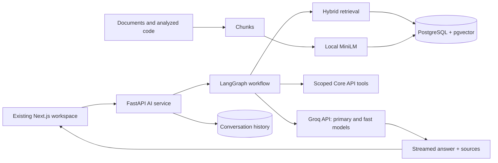

# Kraivor: Groq-only GenAI capstone

Kraivor is a developer intelligence workspace: connect or upload a codebase,
analyze it, upload supporting documents, and ask questions grounded in your own
code and knowledge. The existing workspace, projects, notes, analysis screens,
and conversation UI are retained.

## Start locally

Prerequisites: Docker Desktop with Linux containers, Docker Compose v2.24 or
newer, Python 3.11 or newer, and enough RAM for the services and a local embedding
model (8 GB allocated to Docker is a useful starting point).

From the repository root:

```powershell
python scripts/setup_groq.py
```

The script asks for a Groq key privately if one is not already in `.env`.
It generates local application secrets, preserves existing environment values
and database volumes, builds the services, generates missing signing keys, and
starts the local stack. The Groq key stays on the server. No OpenAI, OpenRouter,
Anthropic, Google, AWS, or Hugging Face API key is required for the capstone flow.

Open http://localhost:3000. Register and verify the account using the message in
the local mail inbox at http://localhost:8025. Create a workspace and open AI.
The gateway is also available at http://localhost:8088 (override with `GATEWAY_PORT`).

For delivery to real inboxes, follow [GMAIL_SMTP.md](GMAIL_SMTP.md). The email
settings are configurable through `.env`; MailHog is the default local inbox.

Subsequent starts:

```powershell
docker compose -f docker-compose.yml -f docker-compose.groq.yml up -d --build
```

Set `GROQ_API_KEY` in `.env` to rotate the key. Model IDs can be changed with
`AI_GROQ_MODEL` and `AI_GROQ_FAST_MODEL`, then recreate the AI service. Defaults
are `openai/gpt-oss-120b` and `openai/gpt-oss-20b`, both hosted by **Groq**. The
`openai/` part of these model IDs does not mean requests use OpenAI's API.
Current IDs are listed in [Groq's model documentation](https://console.groq.com/docs/models).

Local embeddings use sentence-transformers/all-MiniLM-L6-v2, downloaded on first
use and cached in a Docker volume. That download needs internet access but no
API key. First indexing is slower while the model loads. Groq account limits
still apply; the application does not promise unlimited free inference.

## Demonstration

1. Open a workspace's AI page and choose **Add knowledge**. Upload a UTF-8 text,
   Markdown, code file, or a text-based PDF. Wait for the indexed-chunk count.
2. Ask a question containing a fact from the document. The answer should cite
   `[S1]` and list the document and its line range.
3. Ask a follow-up such as “Why was that chosen?” to demonstrate conversation
   memory. Reload the page to demonstrate persistent history.
4. Choose **Review** and request a security or architecture review of uploaded
   code. The workflow invokes up to two specialist reviewers before synthesis.
5. Ask “List the projects in this workspace” to demonstrate native Groq function
   calling against scoped workspace tools.
6. Run repository analysis. The clone stage indexes code into the workspace's
   retrieval store, and the report's finding explanations and executive summary
   use the same Groq key.

Public Git repositories do not need a GitHub token. Private GitHub App/OAuth
integration remains an optional integration and needs its own GitHub setup.

## GenAI concepts implemented

| Concept | Implementation |
| --- | --- |
| Prompt engineering | Separate planner, specialist, and synthesis prompts; evidence treated as data |
| Structured generation | JSON planner output validated with Pydantic; findings enrichment parses JSON |
| RAG | Uploaded documents and analyzed code ground answers in workspace evidence |
| Chunking | Overlapping chunks retain source filenames and line ranges |
| Embeddings | Local normalized 384-dimensional MiniLM sentence vectors |
| Vector database | PostgreSQL pgvector stores and searches chunk embeddings |
| Hybrid retrieval | Cosine nearest neighbors and PostgreSQL full-text search fused with reciprocal-rank fusion |
| Agent workflow | LangGraph: retrieve → plan/tools → specialist reviewers → synthesis |
| Function calling | Groq selects read-only tools; user/workspace identity is supplied by the server |
| Memory | Persistent conversation messages are loaded as recent-turn context |
| Streaming | Final answer tokens stream from Groq over SSE; cancellation propagates through the frontend proxy |
| Grounding | Source labels, evidence snippets, line ranges, citation normalization and invalid-ID filtering |
| Evaluation | Reproducible fact-containment, retrieval, citation-validity, and latency checks |
| Operational controls | Per-user rate limits, bounded workflow concurrency, timeouts, and usage tracking |

This is inference and retrieval over existing models. It does not train or
fine-tune a foundation model, and it does not expose hidden model reasoning.
Specialists are separate model calls with explicit roles, rather than separate
trained models. The workflow trace records steps, not private chain-of-thought.

## Architecture



The LLM client enforces Groq's endpoint even for legacy saved model selections
and old database routes. Provider settings and model selection show Groq only.
Embeddings run locally. Analysis artifacts use local persistent storage in the
capstone configuration, so report generation does not require an S3 account.

## Verification and evaluation

`scripts/create_capstone_demo.py` is a test-fixture helper intended to run inside
the identity container. It creates a separate verified demonstration user and
writes credentials to `/tmp/kraivor-capstone-session.json`; it prints no key or
token. Copy that file into the repository's ignored `tmp/capstone-session.json`.
Do not share that file or commit it.

```powershell
docker cp scripts/create_capstone_demo.py kraivor-identity:/tmp/create_capstone_demo.py
docker exec kraivor-identity python /tmp/create_capstone_demo.py
docker cp kraivor-identity:/tmp/kraivor-capstone-session.json tmp/capstone-session.json
python scripts/smoke_groq.py
python scripts/smoke_registration.py
python scripts/smoke_analysis_groq.py
python scripts/evaluate_groq.py
cd frontend
npm ci
npm run typecheck
npm test
npm run build
```

The smoke check creates an isolated workspace and document, verifies retrieval,
asks Groq a cited question, checks stable stored messages, streams a follow-up,
and checks rejection of an unknown workspace. The evaluation script uses the
same Orion fixture and writes `tmp/groq-evaluation.json`.

Evaluation metrics are observable proxies. Valid source IDs and expected words
are not proof that every generated claim is correct. Review cited passages when
assessing the capstone's answer quality.

## Limits and troubleshooting

- Knowledge uploads: 5 MB, 100 PDF pages, and 1,000,000 extracted characters. Scanned PDFs
  without embedded text need OCR before upload.
- Analysis ZIP uploads use the analysis service's configured upload limit
  (1 MB by default), with at most 5,000 entries and 50 MB extracted content.
- Repository indexing: up to 200 files and 5 MB of text per run; files above
  100,000 characters are skipped. This keeps local indexing bounded.
- Local setup is intended for a single-machine demonstration. Public deployment
  needs its own HTTPS, secrets, backup, and infrastructure configuration.
- Groq rate limits are shared by the single key. Retry after a quota/rate-limit
  response; selecting another provider is not part of this edition.
- If indexing cannot load MiniLM, check the AI container's internet access and
  embedding volume. Never silently substitute random vectors.
- If workspace creation hangs, inspect DynamoDB Local. A new named volume must
  be writable; the capstone override handles this and creates the chat tables.
- Existing optional OAuth, push notifications, and external research connectors
  are not prerequisites for the documented GenAI flow.
